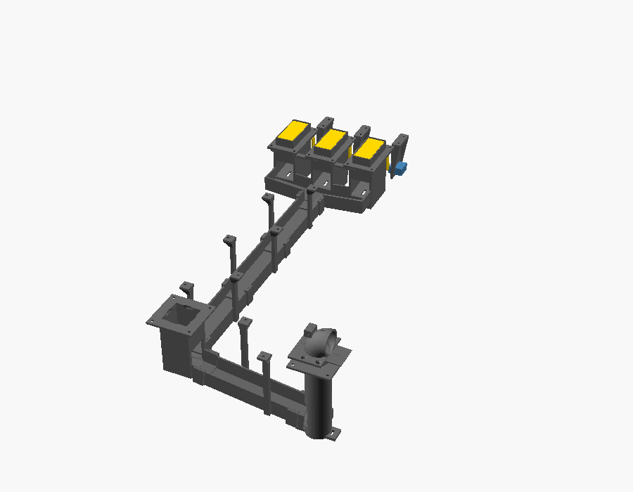
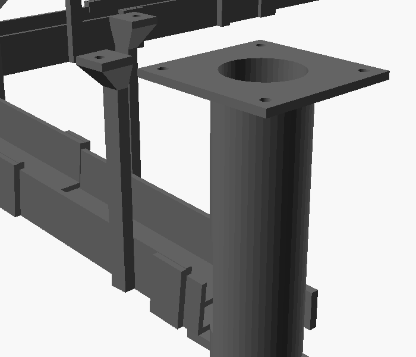
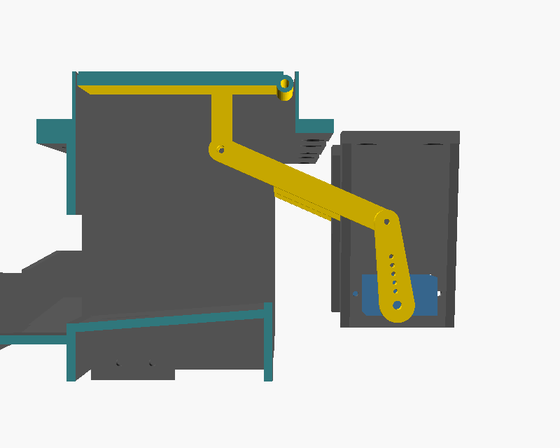
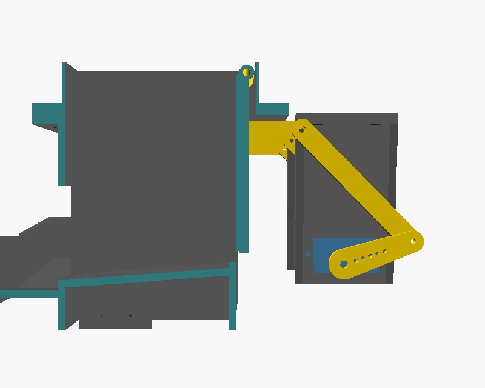

# 3D-printed ball return

The ball return is 3D-printed: everything under the playfield that gets a ball
from the three trapdoors and the outhole back up into the shooter lane, and the
short bend on top that turns it into the lane. The models are in
[`hardware/3d/`](../hardware/3d/). You don't need any 3D-modelling experience:
they're written as code, with every measurement of your table in one file.
Making them fit means measuring the table and typing the numbers in.



*The whole return, seen from above with the playfield hidden, sized for this
table: the trapdoors (top right), the return run down the
table, the outhole funnel (left), and the serve run across to the ball lift,
with its exit on top.*

## How it works

1. **The trapdoors.** Each hole has its own frame, whose thin sleeve slides up
   into the hole. The flap, topped with a 1 mm metal plate so it's flush with
   the playfield, is hinged along its back edge. When the game opens it, its
   servo swings it down through a rib under its middle, a link and a crank,
   until it hangs straight down, clearing the hole. Closed, the servo holds it
   flush.
2. **The catch boxes.** A ball dropping through lands in that trapdoor's own
   box, rolls forward over that trapdoor's microswitch, and drops into the
   collector trough across the front.
3. **The return run.** The trough feeds a channel that hangs under the
   playfield and runs down the table to the outhole. It stays level with the
   playfield: the playfield's own slope keeps the ball rolling.
4. **The outhole funnel.** Drained balls drop into it from above, trapdoor
   balls arrive from the return run, and both roll out along the serve run.
5. **The ball lift.** The serve run brings every ball to a tube under a hole
   beside the shooter lane. The ball waits on the ball-serve coil's plunger,
   holding the outhole switch closed. When the game serves a ball, the coil
   kicks it up the tube. The return is built for **one ball in the machine**
   (assumed, as the game serves the same ball again each time): take any
   others out, or the next one would roll onto the plunger as soon as the
   first was kicked.
6. **The ball-lift exit.** On top of the playfield, over the hole (hidden under
   the apron), the tube bends from straight up to sideways, so the ball comes
   out heading for the lane. It rolls down a short ramp, through the opening in
   the shooter lane's wall, and down the lane to the plunger. The ramp only
   slopes down into the lane, so a ball that rolls back down the lane after a
   weak plunge goes past the opening to the plunger again. A kick too weak to
   get the ball round the bend drops it back down the tube. Once #45 is merged
   the game serves it again; until then, that ends the ball.



*The ball lift, cut through the middle: the serve run (left) arrives at the
bottom of the tube, where the cup (red) waits on the coil's plunger. The tube
rises through the playfield and bends over towards the shooter lane's wall
(right).*

| Closed | Open |
|---|---|
|  |  |

*The right-hand trapdoor's drive, cut away beside it: the rib under the middle
of the flap (top), the link, and the crank on the servo. Opening, the servo
turns the crank about 80 degrees and the flap swings down to hang straight,
with the rib swung back behind it.*

## The parts

| Part | File | Print | What it does |
|---|---|---|---|
| Trapdoor frame | `trapdoor_frame.scad` | 3 | Slides up into a trapdoor hole and screws on underneath. Holds the flap's hinge pin. Its sleeve's walls are 1 mm thick: print with a 0.4 mm nozzle. |
| Trapdoor flap | `trapdoor_flap.scad` | 3 | Sits in the frame, with a metal plate glued on top, and pivots on its pin. The rib underneath joins the link. |
| Trapdoor link | `trapdoor_link.scad` | 3 | Joins a flap's rib to its crank. |
| Trapdoor crank | `trapdoor_crank.scad` | 3 | Screws to the servo's horn and turns the link. |
| Servo hanger | `trapdoor_servo_hanger.scad` | 3 | Screws under the playfield behind a trapdoor and holds its servo. |
| Trapdoor collector | `trapdoor_collector.scad` | 1 | The three catch boxes, with a microswitch mount each, and the trough that feeds the return run. |
| Return run | `return_run_segment.scad` | one of each segment | The channel down the table to the outhole, in segments that fit a printer. Each hangs from the playfield on two posts. |
| Outhole funnel | `outhole_funnel.scad` | 1 | Catches drained balls and the return run, and feeds the serve run. |
| Serve run | `serve_run_segment.scad` | one of each segment | The channel across to the ball lift, sloping down. |
| Ball lift | `ball_lift.scad` | 1 | The tube up to the hole beside the shooter lane, with mounts for the ball-serve coil and the outhole switch. |
| Ball-lift exit | `ball_lift_exit.scad` | one of each half | Screws on top of the playfield over the hole, and bends the ball's path over through the lane's wall into the shooter lane. |
| Ball-lift cup | `ball_lift_cup.scad` | 1 | Clamps onto the coil's plunger with a grub screw and cradles the waiting ball. |

`assembly.scad` shows everything in place; it isn't printed. The files in
`hardware/3d/checks/` check that nothing collides: see step 4.

## 1. Install OpenSCAD

[OpenSCAD](https://openscad.org) is free. Use a recent **development snapshot**
from the [downloads page](https://openscad.org/downloads.html#snapshots), not
the old 2021 release; CI checks the models with the latest snapshot too. On a
Mac with Homebrew:

```sh
brew install --cask openscad@snapshot
```

## 2. Measure your table

Most sizes in `hardware/3d/measurements.scad` are measured from this table
(the playfield, trapdoors, outhole and shooter lane); the rest, such as the ball
lift and the ball-serve coil, are placeholders, and the file says which. A test
checks the playfield, trapdoors, outhole and shooter lane agree with the
playfield map, `docs/playfield.svg`, so change both together. With digital calipers and a tape measure (see the
[shopping list](shopping-list.md#9-tools)), measure, on the underside of the
playfield:

- **The playfield's thickness** at the trapdoor holes.
- **Each trapdoor hole's width** (across the table) **and length** (up the
  table), and the distance between the holes' centres. If the holes differ,
  use the smallest.
- **The metal plates' thickness**, for the tops of the flaps.
- **Where things are**, measured from the playfield's **bottom-left corner**
  (nearest the player's left hand): the centre of the middle trapdoor hole,
  the centre of the outhole and its diameter, and the centre of the hole beside
  the shooter lane that the ball is lifted through, and its diameter.
- **The shooter lane**, on top of the playfield: where its wall (the one with
  the opening the ball rolls in through) is and how thick it is, the opening's
  width and height, the lane's width, where the plunger's tip is at rest, and
  how much room there is above the hole, under the apron. The model assumes the
  opening is straight across from the hole: say if it isn't.
- **The ball-serve coil**: its plunger's diameter, and the distance between its
  mounting screws.

Also check what's already under the playfield along the route: the return run
goes straight from the trapdoors to the outhole, and the serve run straight
across to the shooter lane. `pnpm run export:3d` prints how far below the
playfield the deepest part reaches (about 120 mm on this table), and
the ball-serve coil hangs below that. Note anything in the way (coils, wiring,
old brackets, the old outhole mechanism) and the depth to the cabinet floor.

Photos of the underside with a ruler in shot help a lot if the routes need
changing.

## 3. Type in your measurements

Open `hardware/3d/measurements.scad` in OpenSCAD (or any text editor), change
the numbers, and save. Every part reads this file, so they always fit each
other, and the runs are re-routed and re-split to suit. Change nothing else in
it. Set `max_print_length` to the longest part your printer (or printing
service) can print.

If a measurement can't work, OpenSCAD stops with a message saying why, such as
a trapdoor hole being too short for the ball to fall past the open flap.

## 4. Check it

1. Open `assembly.scad` and press **F5** for a quick preview. Drag to turn it
   round, scroll to zoom, and look for anything that would clash with what's
   under your playfield.
2. Open **Window → Customizer** for the options: tick **open** to see the
   trapdoors open, **section** to cut beside a trapdoor's drive,
   **lift_section** to cut through the ball lift, and **show_playfield** to
   show the playfield.
3. Open each file in `hardware/3d/checks/` and press **F6**. Each must say
   **"Current top level object is empty"**:
   - `trapdoor_swing.scad`: as the trapdoors open, nothing they move hits
     anything else.
   - `ball_paths.scad`: a ball can roll the whole way, from each trapdoor and
     the outhole to the plunger in the shooter lane, without touching
     anything, and a ball rolling back down the lane rolls past the exit.
   - `parts_overlap.scad`: no two parts overlap where they're fitted.

   If something appears instead, that's where the parts collide. Or, from the
   repository, run all the checks at once: `pnpm run check:3d`.

## 5. Export the files for printing

From the repository, export every part, each run segment separately, into
`target/3d/`:

```sh
pnpm run export:3d
```

It prints each part's size. Or, in OpenSCAD: open a part, press **F6**, then
**File → Export → Export as STL**. For the run segments and the exit's
halves, choose each **segment** in the Customizer in turn and export each
one.

## 6. Get them printed

You don't need your own printer:

- **A library or makerspace:** many UK libraries and makerspaces have 3D
  printers, and people happy to help with a first print.
- **An online service:** upload the STL files and the parts arrive by post.
  [JLCPCB](https://jlcpcb.com/3d-printing) and
  [Craftcloud](https://craftcloud3d.com) both do this.
- **Your own printer:** a Bambu Lab A1 mini (about £180–250) is a common
  choice that works well out of the box.

Whichever you use, ask for:

- **Material: PETG**, not PLA. It's tougher, and it won't soften in the warmth
  under a playfield; PLA starts to at about 55 °C.
- **0.2 mm layers, 4 walls (perimeters), 30% infill.** The trapdoor frames'
  sleeves are only 1 mm thick, so they get 2 walls: printing at home, use a
  0.4 mm nozzle; with a service, check its minimum wall thickness for FDM is
  1 mm or less.
- **Supports** for the collector, the outhole funnel and the ball lift. The
  other parts print without.

Each part's file says which way up to print it.

**Try the ball lift first.** How hard the coil needs to kick, and whether the
ball gets round the bend every time, can only be found on the real machine.
So print the ball lift, its cup and its exit first, fit them with the coil,
and serve a ball a few times from test mode's coil stage before printing the
rest.

## 7. Fit it

1. **Trapdoors.** Cut each metal plate to the size `trapdoor_flap.scad` prints
   in OpenSCAD's console (26.3 × 58.3 mm on this table), and file the edges
   smooth. Glue it to the top of its flap, centred with about 0.5 mm of flap
   showing all round, with a thin layer of epoxy or contact adhesive, so it
   ends up flush with the playfield. Cut each hinge pin (2 mm steel rod) to the
   length the flap file prints (29.7 mm here) before fitting it: there's only
   0.2 mm spare each side once the frame is in, so it can't be trimmed after.
   Push it through its frame, the flap's knuckle and out the other side, with
   an even amount showing each side. If the frame's holes are too tight, open
   them with a 2 mm drill. Slide each
   frame up into its hole and screw it on with 3.5 × 9.5 mm wood screws: **no
   longer than 9.5 mm**, or they'll come through the playfield's artwork. The
   wood either side of the sleeve keeps the pin from sliding out.
2. **Servos.** Screw each servo into its hanger, shaft pointing left, and screw
   the hanger under the playfield behind its trapdoor. Screw a crank to each
   servo's single-arm horn and press it onto the shaft. Join the flap's rib to
   the crank with a link, with an M2 × 10 mm screw at each end (into the rib
   and into the crank). Set the angles in test mode (wiring guide section 7f).
3. **Collector.** Screw a lever microswitch under each catch box, its lever up
   through the slot, and screw the collector to the frames' front flanges with
   M3 × 6 mm self-tapping screws, one into each frame.
4. **Runs.** Fit the return run's segments in order from the collector, each
   socket over the end of the part before, and screw their posts to the
   playfield. Then the outhole funnel under the outhole, the serve run's
   segments, and the ball lift under the hole beside the shooter lane.
5. **Ball lift.** Bolt the ball-serve coil under the lift's base. Slide the cup
   onto its plunger and tighten an M3 × 8 mm grub screw into the hole in the
   cup's side until it grips the plunger: it must not come off, or it would fly
   up the tube with the ball. (Assumed, *verify*: a plain plunger end. If yours
   is threaded or has a cross-hole, say so and the cup can use that.) Screw the
   outhole switch to the tab on the tube with its lever through the slot. On top of the playfield, screw the exit's two
   halves over the hole with the ramp through the opening in the lane's wall,
   and join them through the tab on top with an M3 × 16 mm self-tapping
   screw.
6. **Roll a ball through** by hand from each trapdoor and the outhole, and
   watch it reach the lift. Then pulse the ball-serve coil in test mode and
   watch the ball roll into the shooter lane. (Pushing it up by hand won't tell
   you much: a hand helps it round the bend.)

If something doesn't fit, change the measurement and print that part again:
that's the point of printing them. Small fit problems usually need
`fit_clearance` adjusting.
