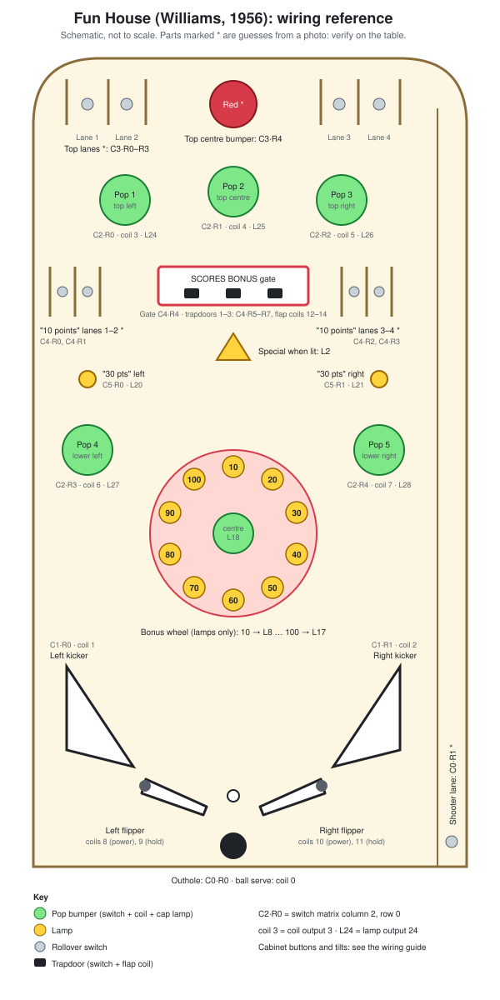
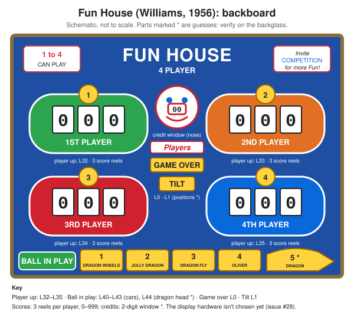

# Wiring guide

A step-by-step guide to wiring the Fun House controller, written for someone
new to electronics. Read it all once before buying parts or picking up a
soldering iron.

- [docs/hardware.md](hardware.md) has the design at a glance.
- `crates/pinball-core/src/playfield.rs` is the source of truth for which part
  goes where. If this guide and that file disagree, the code wins. Please fix
  the guide.

## Playfield map

Every playfield part with its switch matrix position (`C2·R0` = column 2,
row 0), coil number and lamp number. Use it alongside the tables in sections 6
and 7.



## Backboard map

The backglass lamps (player up, ball in play, game over, tilt), each player's
three score reels, and the credit window. The score display hardware isn't
chosen yet (issue #28).



---

## 1. Safety first

A pinball machine combines **mains electricity**, **coil supplies strong enough
to burn**, and **coils that get hot enough to scorch wood** if left on.

1. **Mains (230 V / 110 V) is not a learning project.** Buy ready-made, enclosed
   DC power supplies and have a qualified electrician check the mains wiring:
   - the inlet
   - the fuse
   - the power switch
   - the earth bond to the cabinet and any metal parts

   Never open a power supply.
2. **Never wire anything while it's powered.** Unplug the machine from the wall,
   not just at its switch. Then wait a minute for the power supply capacitors to
   drain.
3. **Fuse every supply rail**, as close to the supply as you can (see section 4).
4. **Build and test in stages.** Test with LEDs before any coil is connected, and
   bring up one coil at a time (see section 9).
5. **Keep a hand on the plug** the first time you power anything new. If you smell
   burning, see smoke, or a coil stays on, pull it.
6. **Work in a dry space**, wear safety glasses when soldering or clipping wire,
   and keep the soldering iron in its stand.

---

## 2. A five-minute electronics primer

You only need a handful of ideas.

| Term | What it means here |
|---|---|
| **Voltage (V)** | Electrical "pressure". The Arduino logic runs at **5 V**; coils run at a much higher voltage. |
| **Current (A)** | How much flows. Coils draw several amps for a split second; logic draws a few thousandths of an amp (mA). |
| **Ground (GND)** | The 0 V reference everything is measured against. **All DC supplies must share a common ground** or nothing works. |
| **Circuit** | Current needs a loop: out from the supply, through the part, back to ground. A switch breaks or completes that loop. |
| **Pull-up resistor** | Gently holds a pin at 5 V (reads "high") when nothing is connected. A closed switch to ground pulls it low. The Arduino has these built in. |
| **Active low** | "On" means 0 V. All our switch inputs work this way: pressed or closed reads low. |
| **Diode** | A one-way valve for current. The end with the **painted band is the cathode**: current flows *towards* the band. |
| **MOSFET** | An electrically controlled switch. A tiny 5 V signal from the Arduino side switches a big coil current on and off. |
| **Flyback diode** | A coil kicks back a high-voltage spike when switched off. A diode across the coil soaks it up. Without one, the MOSFET dies. |
| **Shift register (74HC595)** | A chip that turns 3 Arduino wires into 8 outputs. Chain 12 of them for 96 outputs. |

**Using a multimeter:** you'll use it constantly. Learn three settings:

- **Continuity (beep):** checks that a wire or closed switch connects two points.
- **Diode test:** shows which way round a diode is.
- **DC volts:** checks that a supply gives what it should.

---

## 3. Shopping list

The full list, with quantities and links, is in
[shopping-list.md](shopping-list.md). Three rules matter most:

- **MOSFETs must be "logic level"** (fully on with 5 V on the gate) and rated for
  at least twice your coil voltage, e.g. the IRL540N.
- **Choose the coil supply voltage together with your replacement coils.** The
  original 1956 coils were wound for AC and shouldn't be reused on DC.
- **Buy power supplies, MOSFETs and fuses from a reputable distributor**, not a
  marketplace: fakes are common, and these are the safety-critical parts.

---

## 4. Power layout

```
            ┌───────────────────────────────┐
 Mains ───▶ │      Inlet, fuse, switch      │  ◀── have this checked by an electrician
            └──┬─────────┬──────┬───────┬───┘
               │         │      │       │
        ┌──────▼───┐ ┌───▼────┐ ┌▼──────┐ ┌▼────────┐
        │ Coil PSU │ │Lamp PSU│ │ 9 V   │ │ 5 V 2 A │
        │ (DC)     │ │ (DC)   │ │Arduino│ │ sound   │
        └─┬──────┬─┘ └─┬────┬─┘ └─┬───┬─┘ └─┬─────┬─┘
        +V│  fuse│-  +V│fuse│-   +│   │-   +│fuse │-
          ▼      │     ▼    │     ▼   │     ▼     │
       coils     │   lamps  │  Arduino│  WAV      │
                 │          │  barrel │  Trigger  │
                 ▼          ▼  jack   ▼           ▼
              ══════════ COMMON GROUND POINT ══════════
```

Every supply, the 5 V sound adaptor included, is fed from the machine's
**switched mains inlet**, so the power switch turns everything off at once.
**Have the electrician fit all of them.** Don't splice an adaptor into the mains
wiring yourself. A plug-in adaptor can go in an enclosed multi-socket that the
electrician wires to the inlet.

- **Common ground:** run every DC supply's negative (–) terminal, and the
  Arduino's GND, to **one** ground point, such as a terminal block. Without a
  shared ground the Arduino's 5 V signals mean nothing to the drivers.
- **Fuses:** put one in each positive (+) rail, right at the supply. As a
  starting point:
  - coil rail: a slow-blow fuse rated for the supply, e.g. 5 A
  - lamp rail: about 25% above total lamp current
  - sound rail (5 V): 2 A
- **Arduino power:** use the barrel jack (7–12 V; 9 V is ideal). Its 5 V pin can
  power the 74HC595 chips, which draw very little, but **nothing else**.
- **Sound power:** the WAV Trigger has its own 5 V supply (section 7d). Only
  that supply's negative (–) goes to the common ground point; never join its
  +5 V to the Arduino's 5V pin.
- **Coil power off switch:** fit an easy-to-reach switch or interlock that cuts
  the coil supply only. You can then test switches and lamps with coils dead.

---

## 5. Wiring the Arduino

Fit the screw-terminal shield and wire to its terminals. Pin names are printed
on the board (`22`, `23`, ... and `GND`, `5V`).

| Arduino pin | Goes to | Section |
|---|---|---|
| 22–29 | Switch matrix **columns** 0–7 (D22 = column 0) | 6 |
| 30–37 | Switch matrix **rows** 0–7 (D30 = row 0) | 6 |
| 38–45 | Direct switches 0–7 (D38 = direct 0) | 6 |
| 51 (MOSI) | 74HC595 #1 pin 14 (data in) | 7 |
| 52 (SCK) | Every 74HC595 pin 11 (shift clock) | 7 |
| 49 | Every 74HC595 pin 12 (latch) | 7 |
| 48 | Every 74HC595 pin 13 (output enable) + 10 kΩ pull-up to 5 V | 7 |
| 5V | Every 74HC595 pin 16 and pin 10 | 7 |
| GND | Common ground point, every 74HC595 pin 8, every ULN2803 pin 9 | 4, 7 |
| 18 (TX1) | WAV Trigger serial RX, **through a 1 kΩ resistor** | 7d |
| 19 (RX1) | WAV Trigger serial TX; optional, for future status messages | 7d |
| USB | Your computer, for flashing and the serial console | 9 |

Leave pins 50 and 53 unconnected; the SPI hardware uses them.

---

## 6. Switches

### Direct switches (cabinet buttons and tilts)

These are the simplest. Wire **one side of the switch to its Arduino pin** and the
**other side to GND**. No diode or resistor is needed: the Arduino's internal
pull-up does the rest.

```
 Arduino pin 38 ───────o  o─────── GND
                     (switch)
```

| Direct input | Arduino pin | Switch |
|---|---|---|
| 0 | 38 | Left flipper button |
| 1 | 39 | Right flipper button |
| 2 | 40 | Start button |
| 3 | 41 | Tilt (plumb bob) |
| 4 | 42 | Slam tilt |
| 5–7 | 43–45 | Spare |

### The switch matrix (playfield switches)

There are more playfield switches than pins, so they're arranged in a grid.
The firmware pulls one **column** wire low at a time and checks which **row**
wires go low with it. Each switch sits where its column and row cross.

**Every matrix switch needs its own 1N4148 diode.** Without diodes, two closed
switches can make a third, open one look closed ("ghosting").

Wire each matrix switch like this:

```
 Row wire ──────o  o──────▶|────── Column wire
 (D30–D37)    (switch)   diode     (D22–D29)
                    anode   band (cathode)
                         towards the column
```

**Diode direction matters:**

- The **band goes towards the column wire**.
- Fit the diode right at the switch, soldered to one of its lugs.
- Check every diode with the multimeter's diode test before closing up. It should
  read about 0.6 V one way and nothing the other way.

A practical way to wire it:

- **Columns:** run one wire per column around the playfield, daisy-chained to
  every switch in that column (to the diode's band end).
- **Rows:** do the same for each row (to the switch's other lug).
- **Labels:** label both ends of every wire, e.g. `C2` or `R4`.

Current assignments, from `playfield.rs`:

| Switch | Column (pin) | Row (pin) |
|---|---|---|
| Outhole | 0 (D22) | 0 (D30) |
| Shooter lane | 0 (D22) | 1 (D31) |
| Left kicker | 1 (D23) | 0 (D30) |
| Right kicker | 1 (D23) | 1 (D31) |
| Left side kicker (under the lower-left pop bumper) | 1 (D23) | 2 (D32) |
| Right side kicker (under the lower-right pop bumper) | 1 (D23) | 3 (D33) |
| Pop bumper: top left | 2 (D24) | 0 (D30) |
| Pop bumper: top centre | 2 (D24) | 1 (D31) |
| Pop bumper: top right | 2 (D24) | 2 (D32) |
| Pop bumper: lower left | 2 (D24) | 3 (D33) |
| Pop bumper: lower right | 2 (D24) | 4 (D34) |
| Top bumper ("10 when lit") | 2 (D24) | 5 (D35) |
| Top striped rubbers: left, right (*verify* that they're switches) | 3 (D25) | 0–1 (D30–D31) |
| "10 points" lanes 1–4 (left to right) | 4 (D26) | 0–3 (D30–D33) |
| Trapdoors 1–3 in the "Scores Bonus" box (left to right) | 4 (D26) | 5–7 (D35–D37) |

Columns 5–7 and any unused positions are free for new switches. Add them to
`playfield.rs` and this table together.

**Testing a matrix switch with power off:** set the multimeter to diode test.
Put the red probe on the row wire and the black probe on the column wire. With
the switch closed it should read about 0.6 V; with it open, nothing.

---

## 7. Outputs: shift registers, coils and lamps

### 7a. The 74HC595 chain

Twelve 74HC595 chips are chained so that 3 Arduino wires drive 96 outputs.

- **Chips 1–4** (nearest the Arduino) drive coils.
- **Chips 5–12** drive lamps.

The 74HC595 pinout (notch at the top, pin 1 top-left, counting down the left
side and back up the right side):

```
            ┌───U───┐
       Q1  1│       │16 VCC (5 V)
       Q2  2│       │15 Q0
       Q3  3│       │14 DS (data in)
       Q4  4│  595  │13 OE (output enable, active low)
       Q5  5│       │12 ST_CP (latch)
       Q6  6│       │11 SH_CP (shift clock)
       Q7  7│       │10 MR (reset, active low)
      GND  8│       │ 9 Q7' (data out to next chip)
            └───────┘
```

Wire **every** chip the same way, except for data:

| 595 pin | Connect to |
|---|---|
| 16 (VCC) | 5 V, plus a **100 nF capacitor from pin 16 to pin 8**, as close to the chip as possible |
| 8 (GND) | Ground |
| 10 (MR) | 5 V (never reset) |
| 11 (SH_CP) | Arduino D52 (all chips share it) |
| 12 (ST_CP) | Arduino D49 (all chips share it) |
| 13 (OE) | Arduino D48 (all chips share it) **and a 10 kΩ resistor from this line to 5 V** |
| 14 (DS) | Chip 1: Arduino D51. Chip *N*: pin 9 of chip *N–1* |
| 9 (Q7') | Pin 14 of the next chip (unconnected on chip 12) |

**The 10 kΩ pull-up on OE is a safety feature, so don't skip it.** It holds every
output **off** whenever the Arduino isn't actively driving pin 48: at power-on,
while flashing, and during a reset. The firmware only enables outputs after
clearing them.

**Which output is which:** output Qn on chip *k* drives:

- **Chips 1–4:** coil number `8 × (k − 1) + n`
- **Chips 5–12:** lamp number `8 × (k − 5) + n`

So Q0 on chip 1 is coil 0, and Q3 on chip 6 is lamp 11.

### 7b. Coil drivers

One MOSFET circuit per coil output (or per winding, for flippers):

```
                           Coil +V (fused)
                               │
                        ┌──────┤
                 band ─▶│      █ coil
           1N4004 diode ▲      █
          (band to +V)  │      █
                        └──────┤
                               │
 595 Qn ──[220 Ω]──┬──────── Gate ┐
                   │              │ MOSFET (e.g. IRL540N)
                [10 kΩ]  Drain ───┘  (drain = coil side)
                   │     Source ──┐
                  GND             │
                                 GND (common ground)
```

In words:

1. **Coil supply:** coil supply + (through its fuse) goes to one coil lug.
2. **Coil to MOSFET:** the other coil lug goes to the MOSFET's **drain**.
3. **MOSFET to ground:** the MOSFET's **source** goes to ground. Use thick 18 AWG
   wire back to the common ground.
4. **Gate:** the 595 output goes through a **220 Ω** resistor to the MOSFET's
   **gate**.
5. **Gate pull-down:** a **10 kΩ** resistor from the gate to ground keeps the
   MOSFET off if a wire comes loose.
6. **Flyback diode:** fit a **1N4004 directly across the coil lugs**, with the
   **band towards the + supply side**. Many replacement coils already have one;
   check before adding another. If a diode is in backwards, the coil shorts the
   supply and the fuse blows.

For the IRL540N (TO-220 package), facing the printed side with the legs down,
the legs are **Gate, Drain, Source** from left to right. Check the datasheet for
any other part.

**Flippers** use two windings: a strong **power** winding for the flip and a weak
**hold** winding to keep the flipper up. A dual-wound flipper coil usually has
three lugs. Wire:

- the **common lug** to + supply
- each of the other two lugs to **its own MOSFET**, with a flyback diode across
  each winding

Confirm which lug is which with the coil's datasheet or supplier. The power
winding has the *lower* resistance; measure it with the multimeter's Ω setting,
power off.

**Trapdoor flaps** (the three trapdoors in the "Scores Bonus" box) use the
same single-coil MOSFET circuit. Unlike a kicker, a flap can be **held open for
a long time**, so:

- Each flap coil must be rated for **continuous duty** at your coil supply
  voltage. A normal kicker coil held on will overheat and burn out.
- Check that the flap is closed when its coil has no power, so that it fails
  safe. The firmware assumes energised = open (*verify* on the real mechanism).
- After it has been held open for a few minutes, check by touch that the coil
  is no more than warm.

| Coil | Number | Chip | Output (595 pin) |
|---|---|---|---|
| Ball serve | 0 | 1 | Q0 (15) |
| Left kicker | 1 | 1 | Q1 (1) |
| Right kicker | 2 | 1 | Q2 (2) |
| Pop bumpers 1–5 (top left, top centre, top right, lower left, lower right) | 3–7 | 1 | Q3–Q7 (3–7) |
| Left flipper power | 8 | 2 | Q0 (15) |
| Left flipper hold | 9 | 2 | Q1 (1) |
| Right flipper power | 10 | 2 | Q2 (2) |
| Right flipper hold | 11 | 2 | Q3 (3) |
| Trapdoor flaps 1–3 (left to right) | 12–14 | 2 | Q4–Q6 (4–6) |
| *Optional:* bell for the 1s | 15 | 2 | Q7 (7) |
| *Optional:* bells for the 10s, 100s | 16–17 | 3 | Q0–Q1 (15, 1) |
| Top bumper ("10 when lit") | 18 | 3 | Q2 (2) |
| Side kickers: left, right | 19–20 | 3 | Q3–Q4 (3–4) |

### 7c. Lamp drivers

Each ULN2803A drives 8 lamps. It connects a lamp's negative side to ground when
its input is high.

```
            ┌───U───┐
      IN1  1│       │18 OUT1
      IN2  2│       │17 OUT2
       ...  │ ULN   │ ...
      IN8  8│ 2803A │11 OUT8
      GND  9│       │10 COM
            └───────┘
```

- **INx (pins 1–8):** Q0–Q7 of the matching 595 (Q0 → IN1, Q1 → IN2, and so on)
- **GND (pin 9):** ground
- **COM (pin 10):** lamp supply +
- **OUTx (pins 18 down to 11):** the lamp's negative side. OUT1 is pin 18 and
  OUT8 is pin 11.
- **Lamp's other side:** lamp supply + (fused)

The ULN2803A drops about 1 V, so 6.3 V LED bulbs may look slightly dim. If they
do, raise the lamp supply a little, staying within the bulbs' rated voltage.
Each chip handles up to 500 mA per lamp but less in total, which is plenty for
LEDs.

| Lamp | Number | Chip | Output |
|---|---|---|---|
| Game over | 0 | 5 | Q0 |
| Tilt | 1 | 5 | Q1 |
| Special when lit | 2 | 5 | Q2 |
| Trapdoor lamps 1–3 ("trap door open when lite is lit") | 3–5 | 5 | Q3–Q5 |
| "Advance bonus" by the top rubbers: left, right | 6–7 | 5 | Q6–Q7 |
| Bonus wheel 10–80 | 8–15 | 6 | Q0–Q7 |
| Bonus wheel 90, 100 | 16–17 | 7 | Q0–Q1 |
| Bonus wheel centre | 18 | 7 | Q2 |
| "30 points" below lanes 1–4 | 20–23 | 7 | Q4–Q7 |
| Pop bumper caps 1–5 | 24–28 | 8 | Q0–Q4 |
| Top bumper cap | 29 | 8 | Q5 |
| "Advance bonus" below the lanes: left, right | 30–31 | 8 | Q6–Q7 |
| Backboard: player up 1–4 | 32–35 | 9 | Q0–Q3 |
| Backboard: ball in play 1–5 (four train cars, then the dragon's head *) | 40–44 | 10 | Q0–Q4 |

### 7d. Sound (WAV Trigger)

Sound comes from a **WAV Trigger** by Robertsonics, a board that plays WAV files
from a microSD card and **mixes up to 14 sounds at once**. Pinball triggers
sounds quickly, so several often overlap. The Arduino tells it which tracks to
play over a serial connection at 57600 baud.

| WAV Trigger connection | Connect to |
|---|---|
| **5Vin** (J8, pin 4) | **The separate 5 V sound supply** (section 4), not the Arduino's 5V pin: the board can draw over 200 mA with its amplifier on. Leave the barrel jack unused; the user guide says not to use both. |
| GND | The common ground point |
| Serial **RX** (on the 6-pin serial header, laid out like a SparkFun FTDI Basic; use the labels printed on the board) | Arduino **D18 (TX1)**, through a **1 kΩ resistor** |
| Serial TX | Arduino D19 (RX1); optional, for future status messages |
| Speaker header (2 pins) | The speaker, 4–8 Ω. The firmware turns the on-board amplifier on at start-up. |
| *Optional:* stereo line-out jack | An external amplifier, if the on-board one isn't loud enough |

Leave the small **Load/Run** switch next to the power connector on **Run**.

**The SD card:**

1. Run `pnpm run render:sounds`. This writes every sound to `target/sd-card/`,
   named `001_Pop-bumper.wav`, `003_Lane-chime.wav` and so on. The WAV Trigger
   takes the track number from the first three digits.
2. Format a microSD card (up to 32 GB) as **FAT32 with a 32 KB allocation
   size**. Smaller allocation sizes can cause clicks.
3. Copy the files to the card's **root** (not a folder) and put it in the board.
4. Power-cycle the WAV Trigger whenever you change the card. It only reads the
   card at power-on, and blinks three times when it has found the files.

The files are 16-bit 44.1 kHz stereo, the only format the WAV Trigger plays.
They're also 6 dB below full scale: the board adds overlapping sounds together,
and its volume control comes after the mix, so full-scale files would clip.

The sounds are cut from free recordings (listed in `docs/sound-credits.md`),
with synthesised versions in `sim/web/sounds.js` as a fallback. The simulator
plays the same files and mixes them the same way, so what you hear there is
what the machine plays. After changing a sound, run `pnpm run render:sounds`
again and re-copy the card.

**Attract music:** track 30 is the whole of "Entrance of the Gladiators"
(2 min 35 s). The core starts it again when it ends, in the same tick as the
light show restarts its beats, rather than using the board's own loop setting:
the user guide says that leaves a small gap, which would slowly put the lamps
out of step with the music. It's stored in the repo as an MP3 to save space;
`pnpm run render:sounds` (which needs ffmpeg) turns it into a WAV for the card.

The firmware waits 2 seconds after power-on while the board reads its card,
then turns the amplifier on and sets the volume (`WAV_TRIGGER_GAIN_DB` in
`crates/pinball-core/src/sound.rs`, −70 to +10 dB). The big moments (game start
and over, tilt, a player joining, replays, bonus collect, special) are
*locked*, so a flurry of chimes can't steal their voices.

### 7e. Optional: real bells

1950s machines rang real bells as the score went up, one stroke per point,
driven by the score motor. None are fitted yet, but the controller is ready
for three: one each for the 1s, 10s and 100s.

- **Wiring:** each bell's coil is wired like any other coil (section 7b), on
  coil outputs 15–17 (see the coil table above), with its own flyback diode.
- **Turning them on:** set `bells: true` in the operator settings
  (`Settings` in `crates/pinball-core/src/game.rs`). The bells then ring one
  stroke per point, at a steady score-motor rhythm (`RING_INTERVAL_MS` in
  `crates/pinball-core/src/bells.rs`). The WAV Trigger stops playing its recorded
  chimes, so the real bells aren't doubled up.
- **Coil limits:** a cautious 15 ms pulse, with at least 50 ms between strokes.
  Check them against the real coils' ratings before use.
- **Try it first:** the simulator's "Real bells fitted" setting plays recordings
  of real bells, so you can hear how it would sound.

---

## 8. Good wiring habits

- **Sizes:** use **18 AWG** for coil power and coil ground returns, and **22 AWG**
  for switches, logic and lamps.
- **Colours:** use one colour per job and stick to it, e.g. red for coil +,
  black for ground, one colour for columns and another for rows.
- **Labels:** label both ends of every wire.
- **Logic vs coil wiring:** keep the Arduino and 595 wiring away from coil power
  runs, and cross them at right angles where you can.
- **Strain relief:** tie wires down with cable ties near each connection so that
  vibration can't work them loose.
- **Insulation:** heat-shrink every solder joint. Don't leave bare metal.
- **Order of work:** wire one assembly, test it, and only then move on.

---

## 9. Bring-up: the order to do things in

Each step only adds one new thing, so when something goes wrong you know where
to look. **Keep the coil supply switched off until step 6.**

1. **Arduino alone, over USB.** Flash the firmware with `cd firmware && cargo run --release`.
   The console should print `Fun House controller ready`.
2. **Direct switches.** Wire the start and flipper buttons (section 6).
   Check each with the multimeter: continuity to ground when pressed.
3. **One shift register and test LEDs.** Build chip 1 only, on a breadboard. Put
   an LED with a 1 kΩ resistor from Q0, Q1 and Q2 to ground:
   - Press start: Q0 (ball serve) should give a very short blink.
   - Q1 and Q2 should stay dark.

   Then build chip 2 the same way, with test LEDs on Q0–Q3:
   - Hold the left flipper button: Q0 (power) blinks and Q1 (hold) stays lit
     until you let go.

   Nothing should light at power-on.
4. **The rest of the chain.** Add the other chips one at a time, checking that
   the test LEDs still behave and that nothing lights at power-on.
5. **Matrix switches.** Wire and diode-test each one with power off (section 6).
6. **The first coil.** Connect **one** MOSFET circuit and **one** coil, ideally a
   kicker. Switch on the coil supply with a hand near the plug. Close the kicker
   switch by hand: you should get one short, sharp kick. If the coil buzzes or
   stays on, cut the power and recheck the flyback diode and MOSFET wiring.
7. **The remaining coils, one by one**, then the lamps.
8. **Sound.** Wire the WAV Trigger and its speaker, and prepare the SD card
   (section 7d). Power on and wait 2 seconds, then press start: you should hear
   the calliope march.

---

## 10. Troubleshooting

| Symptom | Likely cause |
|---|---|
| Nothing works, but the Arduino's power LED is on | Grounds not joined: check the common ground point |
| All outputs on or random at power-on | OE pull-up missing, or D48 not wired |
| Outputs shifted along by one (the wrong lamp or coil fires) | Data chain wiring (pin 9 → pin 14) wrong or loose, or a long noisy clock wire |
| A switch reads closed when it isn't | Diode backwards, missing, or shorted; or a pinched wire touching another |
| Pressing one switch also shows another one | Missing diode (ghosting) |
| Coil buzzes, gets hot, or the fuse blows | Flyback diode backwards, MOSFET shorted (replace it), or a wiring short |
| Coil fires weakly | Supply voltage too low for the coil, or thin wiring/bad crimps |
| MOSFET gets hot | Not a logic-level part, or gate resistor/pull-down wired wrong |
| Board resets when a coil fires | Coil ground return too thin, or shared with logic wiring; give coils their own thick ground run |
| LED bulbs dim | Lamp supply too low after the ULN2803's ~1 V drop |
| No sound | No three blinks at power-on: the card isn't FAT32, or the files aren't in its root or not named `001_…wav`. Blinks but silent: RX wired to D1 (TX0) instead of D18 (TX1), or no speaker on the speaker header. |
| Sound clicks or pops | Card formatted with a small allocation size: reformat FAT32 with 32 KB |
| Sound distorts when lots happens at once | Files at full scale (re-render with `pnpm run render:sounds`, which leaves headroom), or the volume set above 0 dB |
| Sound hisses | 1 kΩ resistor missing on the RX line, or the board powered from the Arduino's 5V pin |

---

## Glossary

- **AWG**: American Wire Gauge. Smaller numbers mean thicker wire.
- **Cathode / anode**: a diode's two ends. Current flows from anode to cathode
  (towards the band).
- **DIP socket**: a socket the chip plugs into, so a dead chip can be swapped
  without soldering.
- **EM**: electromechanical. The original machine ran on relays and switches,
  with no computer.
- **Logic level**: a part that works fully with 5 V control signals.
- **Slow-blow fuse**: a fuse that tolerates short surges (like a coil firing) but
  blows on a sustained overload.
